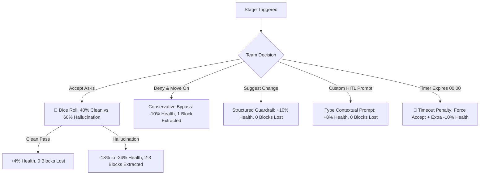

# ⚡ Human-in-the-Loop (HITL) Jenga: AI-Paced Development
> **Salesforce Enterprise Architecture Edition** — A 45-minute interactive Developer Day workshop simulation for 60+ engineers.

[](https://fastapi.tiangolo.com)
[](https://react.dev)
[](https://threejs.org)
[](https://tailwindcss.com)
[](https://developer.mozilla.org/en-US/docs/Web/API/Web_Audio_API)

---

## 🎯 Workshop Objective & Concept

In modern AI-assisted engineering, coding agents generate code at blinding speed. But high velocity without **Human-in-the-Loop (HITL)** architectural verification rapidly destabilizes production systems—extracting critical foundational blocks until the architecture catastrophically collapses.

**HITL Jenga** simulates this dynamic. Teams of 3–4 developers navigate **11 sequential Salesforce AIDLC crisis stages** under high pressure. They must balance **Application Health (starting at 100%)** against **Virtual 3D Tower Structural Integrity** while making critical decisions within a **2-minute countdown timer per stage**.

---

## 🏛️ Real-Time 3D Virtual Architecture Tower

Instead of a physical toy, the game renders a **real-time 3D enterprise architecture tower** in WebGL via Three.js.

### 54 Subsystem Blocks Across 18 Architectural Layers
The tower represents critical components of a production Salesforce ecosystem across 6 categorized subsystems:

- 🛡️ **Security & Identity (Cyan):** `Apex Crypto Engine`, `OAuth 2.0 PKCE`, `Platform Encryption`, `FLS Stripping Core`, `Shield Event Monitor`, `Named Credentials Vault`.
- ⚡ **Governor & Data Limits (Emerald):** `SOQL 100-Query Buffer`, `Heap Size Limiter (12MB)`, `DML 10k Row Lock`, `SOQL Aggregate Chunk`, `Platform Cache (Org)`, `Query Plan Optimizer`.
- ⚙️ **Async & Concurrency (Indigo):** `FlexQueue Scheduler`, `Queueable Chain Buffer`, `Batch Apex Chunk (2k)`, `Future Method Router`, `EventBus Partition`, `Async Apex Limits`.
- 🧩 **UI & Component Layer (Pink):** `LWC Shadow DOM Root`, `LMS Channel Router`, `Lightning Locker Engine`, `GraphQL Wire Adapter`, `Lightning Out Proxy`, `UI Event Synthesizer`.
- 🔄 **Platform Events & Messaging (Amber):** `High-Volume Pub/Sub`, `EMP Connector Worker`, `Kafka Inbound Ingest`, `Event Replay Offset`, `Dead Letter SQS`, `Webhook Deduplicator`.
- 🚀 **CI/CD & DevOps Pipeline (Purple):** `Scratch Org Pool`, `RunLocalTests Gating`, `SonarQube Static Linter`, `PMD Rule Engine`, `Production QuickDeploy`, `Salesforce CLI Deployer`.

### Realistic Physics & Persistent Degradation
- **Targeted Block Removal:** On every risky decision or hallucination failure, the 3D camera orbits to spotlight the exact failing subsystem block.
- **Physical Block Extraction:** The block slides out along its horizontal axis, tilts, and drops onto the cybernetic floor pedestal.
- **Persistent Gaps:** Extracted blocks **stay missing** from the 3D tower matrix throughout the entire game session, creating visible architectural cavities.
- **Dynamic Structural Wobble:** As blocks are lost, the tower physically tilts and oscillates based on calculated center-of-mass stress.
- **Catastrophic 3D Physics Collapse:** If Health reaches 0% or the tower collapses, a dynamic physics simulation is triggered: all 54 blocks pop upward, explode outward with gravitational acceleration ($-34\,\text{m/s}^2$), bounce on the cyber pedestal, and scatter across the ground with pulsing red emergency alarm lights.
- **Post-Mortem 3D Rubble Inspector:** Players can minimize the failure modal to orbit 360° around the scattered rubble or click **"Replay 3D Collapse 💥"** on demand.

---

## 📋 The 11 Salesforce AIDLC Stages

Each stage presents real-world production code containing subtle, catastrophic traps typical of unverified AI code generation:

| # | Stage Title | File Target | Architectural Hazard & Root Cause |
|---|---|---|---|
| **1** | **The Governor Limit Trap** | `AccountTriggerHandler.cls` | SOQL query nested inside a `for` loop (`System.LimitException: Too many SOQL queries: 101`). |
| **2** | **The Security & FLS Bypass** | `CustomerPortalController.cls` | Global `without sharing` class with dynamic SOQL injection vulnerability allowing unauthenticated data exfiltration. |
| **3** | **The Mixed DML Concurrency Trap** | `UserOnboardingService.cls` | Inserting Setup (`User`, `UserRole`) and Non-Setup (`Account`) records in the same synchronous transaction (`MIXED_DML_OPERATION`). |
| **4** | **The Brittle LWC & Shadow DOM Break** | `quoteConfigurator.js` | Direct query selector bypassing Shadow DOM encapsulation (`this.template.querySelector('div')`) with hardcoded API names. |
| **5** | **The Async Queueable Storm** | `ErpSyncQueueable.cls` | Recursive `System.enqueueJob()` without depth guard, exhausting the 250,000 daily async Apex execution limit. |
| **6** | **The Hardcoded ID & Deprecated Namespace** | `LeadRoutingEngine.cls` | Hardcoded 18-character Sandbox RecordTypeId string (`01200000000ABCDAAA`) breaking in production deployment. |
| **7** | **The Friday Production Deploy** | `salesforce-production-deploy.yml` | CI/CD pipeline configured with `testLevel: NoTestRun` directly to Production org, skipping all test coverage validations. |
| **8** | **The Row Lock & Deadlock Collision** | `OpportunityLineItemTrigger.trigger` | Bulk updates without `FOR UPDATE` or account batching causing uncatchable `UNABLE_TO_LOCK_ROW` errors under concurrency. |
| **9** | **The Apex CPU Time Limit Breach** | `InboundWebhookRestService.cls` | Catastrophic ReDoS regex pattern backtracking in JSON payload validation hitting the 10,000ms synchronous CPU limit. |
| **10** | **The EventBus Infinite Recursive Storm** | `InventoryEventTrigger.trigger` | Platform Event trigger publishing new `InventoryUpdated__e` events on every receive, creating an infinite recursive storm. |
| **11** | **The Plaintext Secret & Callout Leak** | `BankingPaymentService.cls` | Hardcoded API Bearer tokens in Apex HTTP headers dumped to standard logs via `System.debug()`. |

---

## ⚡ The 4 Decision Paths

Teams evaluate the AI's proposal at each stage and choose one of four tactical actions:



1. **Accept as-is:**
   - High-stakes dice roll popup with real-time percentage animation.
   - **40% Clean Pass:** AI got it right! Small health boost (+4%), zero blocks pulled.
   - **60% Hallucination Trap:** Hidden bug strikes! Severe health penalty (-18% to -24%), 2 to 3 subsystem blocks extracted.
2. **Deny and Move On (Bypass & Skip):**
   - Low-risk skip. Avoids catastrophic bugs but accumulates technical debt (-10% health, 1 block extracted).
3. **Discuss & Type Custom Prompt (Human-in-the-Loop Iteration):**
   - Interactive prompt modal with keyword suggestions tailored to the current stage (e.g., `bulkify`, `without sharing`, `Named Credential`, `Queueable`).
   - Typing targeted architectural instructions guides the AI to fix the flaw (+8% health restored, zero blocks pulled).
4. **Suggest Change (Structured Architectural Guardrails):**
   - Enforce institutional best practices and automated linter rules (+10% health restored, zero blocks pulled).

---

## ⏱️ Timer & Audio Synthesis

- **2-Minute Stage Countdown:** High-contrast digital timer in the navigation bar.
- **Emergency Critical Phase:** Under 30 seconds, timer transitions to pulsing warning red with rapid audio heartbeat clicks.
- **Zero-Dependency Sound System:** Uses the native Web Audio API to synthesize:
  - Futuristic slide and lock tones when blocks are pulled.
  - Arcade dice roll ratchets.
  - Harmonic victory chords on clean passes.
  - Low-frequency bass drops and glass shatter noise bursts during catastrophic collapse.
  - Heartbeat pulses during critical timeouts.

---

## 🛠️ Tech Stack & Architecture

```
HITL/
├── backend/                  # FastAPI Python Service
│   ├── main.py               # REST API endpoints & CORS middleware
│   ├── game_state.py         # Health, tension, scoring & collapse mechanics
│   ├── stages_data.py        # 11 Salesforce AIDLC scenarios & solution rules
│   └── requirements.txt      # fastapi, uvicorn, pydantic
└── frontend/                 # React 19 + Vite Application
    ├── src/
    │   ├── App.jsx           # Main orchestrator, modal sequencing & audio triggers
    │   ├── components/
    │   │   ├── Virtual3DTower.jsx    # Three.js 18-tier WebGL tower & collapse physics
    │   │   ├── StageArena.jsx        # Scenario viewer, code diff & decision cockpit
    │   │   ├── DiceRollModal.jsx     # Probability roll animation
    │   │   ├── CustomPromptModal.jsx # HITL guidance prompt input
    │   │   ├── GameOverModal.jsx     # Post-mortem incident telemetry & rubble viewer
    │   │   ├── VictoryModal.jsx      # Production deploy success debrief
    │   │   ├── Navbar.jsx            # Stage progression circuit, health bar & timer
    │   │   └── LiveLeaderboardTicker.jsx # Workshop team standings & event feed
    │   └── hooks/
    │       └── useSound.js           # Web Audio API procedural synthesizer
    └── package.json
```

---

## 🚀 Running Locally

> 📖 **Full Setup & Multi-Player Guide:** See [SETUP_GUIDE.md](file:///c:/Users/saubh/Documents/GenAI/AI/HITL/SETUP_GUIDE.md) for detailed step-by-step instructions, troubleshooting, and co-op testing.

### Prerequisites
- Python 3.10+
- Node.js 18+ (or 20+) & npm

### 1. Start the Backend API (FastAPI)
```bash
cd backend

# Create & activate virtual environment (Windows PowerShell)
python -m venv .venv
.\.venv\Scripts\Activate.ps1

# (Or macOS/Linux)
# python3 -m venv .venv && source .venv/bin/activate

pip install -r requirements.txt
python -m uvicorn main:app --host 127.0.0.1 --port 8000 --reload
```
API docs available at: `http://127.0.0.1:8000/docs`

### 2. Start the Frontend (React + Vite)
In a separate terminal:
```bash
cd frontend
npm install
npm run dev
```
Open **[http://localhost:5173](http://localhost:5173)** in your browser.

---

## 👥 Multi-User & Multi-Table Workshop Scaling (20–60+ Developers)

The platform is designed to scale across full workshop rooms with 20–60+ participants:

- **Isolated Table Sessions (`room_id`):**
  Each table or subgroup registers with a unique Table / Room code (e.g., `Table 1`, `Table 2`, `Squad Alpha`). All game actions, health states, and 3D architectural towers are **100% isolated** on the backend in a concurrent `RoomManager` dictionary. One team's decisions or collapses never overwrite another team's progress.
- **Teammate Co-Op Live Sync:**
  Developers sitting at the same table can all open the same room link (e.g. `http://<host>:5173/?room=table-1` or via the **"Copy Link"** button in the navbar). The state synchronizes in near real-time across all their individual screens.
- **Cross-Table Live Rivalry Leaderboard (`/api/leaderboard`):**
  The ticker bar at the top of every screen dynamically aggregates real-time metrics across all active workshop tables, displaying live Health %, Stage Progression, and Collapse alerts as teams race to finish Stage 11.

---

## 🏆 Scoring & Workshop Debrief Lessons

At the end of the simulation (Stage 11 victory or post-mortem incident debrief), teams receive a breakdown of their decisions:

- **AI Velocity Score:** Ratio of stages completed vs time consumed.
- **Architectural Debt Index:** Total subsystem blocks sacrificed.
- **HITL Verification Ratio:** Percentage of stages resolved via human guidance vs blind acceptance.
- **Key Takeaway:** Unchecked AI code generation is like pulling blocks from the foundation of a building. Sustainable development requires developers to act as **critical evaluators and architects**, not passive approvers.
